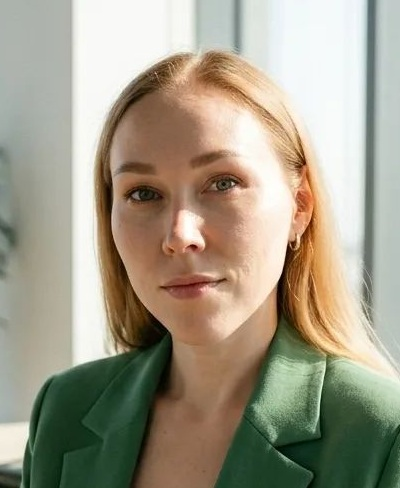

# Софья Спиридонова

**Системный аналитик** · удалённо

[sophyasergeevna@yandex.ru](mailto:sophyasergeevna@yandex.ru) · [GitHub](https://sofia-qa-med.github.io/Sofia-SA-MED.github.io) · [Сетка](https://set.ki/account/TDdZjn6)

---

## О себе
14 лет в разработке и производстве оборудования, из них больше 7 — в медицинской технике. Пишу и сопровождаю техническую документацию (ТУ, РЭ, спецификации, СМК), веду требования, внедряю доработки, тестирую встроенное ПО аппаратов ИВЛ. Вела полный пакет производственной документации на английском для европейского производства.

## Навыки
- **Документация:** техническая и пользовательская документация, инструкции, ТЗ, ТУ, РЭ, нормоконтроль
- **Требования:** сбор, анализ и декомпозиция; функциональные, нефункциональные и бизнес-требования; User Story
- **Качество:** СМК ISO 13485, внутренний аудит, приёмочное тестирование, верификация и валидация
- **Процессы:** моделирование и описание бизнес-процессов, Change Management, постановка задач разработчикам
- **Инструменты:** Codebeamer, Devprom ALM, Jira, Redmine, Draw.io, Figma, SolidWorks, Corel Draw, Excell, draw.io, 1С ERP, PDM
- **Техническое:** SQL, SQLite, JSON API, Bash, SSH, CAN-снифферы, Markdown, Git, Linux, UML, BPMN

## Опыт работы

### Тритон-ЭлектроникС — Системный аналитик
*Июнь 2026 — сейчас · медицинское оборудование*
- Анализ встроенного ПО и интерфейсов аппаратов ИВЛ для модернизации
- Сбор, уточнение и декомпозиция требований для команды разработки
- Координация верификации, валидации и приёмочных испытаний
- Сбор обратной связи и анализ дефектов в клиниках, задачи на улучшение продукта
- Актуализация нормативно-технической документации (ТУ, РЭ, спецификации)
- Наставничество тестировщиков отдела, постановка задач на тестирование
- **Результат:** координирую доработку ПО для успешного выхода на серийное производство, сокращаю время выхода на рынок оперативно управляя бэклогом и координируя процессы верификации и валидации.

### Тритон-ЭлектроникС — Инженер-тестировщик
*Май 2025 — Май 2026*
- Тестирование встроенного ПО и интерфейсов аппаратов ИВЛ
- Методики проверки и сопровождение верификации ПО сторонними службами
- Анализ дефектов по итогам медицинских испытаний
- Декомпозиция задач, актуализация требований (ТУ, РЭ)
- **Результат:** в составе команды провела продукт через медицинские и технические испытания до серийного производства

### Ведал — Ведущий инженер-технолог / менеджер по запуску продукта
*Июнь 2024 — Май 2025*
- Запуск производства медицинского оборудования с нуля
- Разработка СМК для этапов разработки и производства
- Подготовка документации для сертификации медицинской техники
- **Результат:** выстроила процесс сбора требований от поставщиков и сквозную технологическую документацию для всех этапов создания продукта. Отвечала за технологическую готовность продукта к запуску

### БТЛ — Инженер по документации / Configuration manager
*Август 2019 — Март 2024*
- Выпуск полного пакета производственной и конструкторской документации на английском для медицинских изделий (производство в Европе)
- Управление изменениями в документации на этапах R&D и постановки на производство
- Переписка и рабочие коммуникации с европейскими разработчиками и площадками на английском
- **Результат:** обеспечила документацию и управляла изменениями для релизов линейки медицинских изделий, которая зарегистрирована и продаётся по всему миру

### Горизонт — Инженер-технолог
*Октябрь 2012 — Июль 2019*
- Технологическая документация на электромонтаж и сборку приборов, инструкции и технические требования
- Стандарты предприятия, нормоконтроль, технологический контроль конструкторской документации
- Обучение и аттестация персонала, ведение архива документации
- **Результат:** многократное успешное прохождение сертификации производства и аудитов

### Меткор — Технолог-программист
*Июль 2012 — Октябрь 2012*
- Программы раскроя листового металла для станков с ЧПУ (CNC cad, AutoCad, Punch)
- **Результат:** за недолгий срок работы подготовила библиотеки раскроя части номенклатуры деталей для разных типов станков и габаритов материалов.

## Проекты
- **[SRS](https://sofia-qa-med.github.io/SRS/)** — макет страницы требований к аппарату ИВЛ в стиле Codebeamer
- **[python_autotests](https://github.com/Sofia-QA-MED/python_autotests)** — пример API-автотестов на pytest + requests
- **[cypress.js](https://github.com/Sofia-QA-MED/cypress.js)** — UI-автотесты регресса на Cypress

## Образование
**Уральский федеральный университет**, 2012
Химико-технологический факультет, химическая технология монокристаллов, материалов и изделий электронной техники, специалист

## Курсы и сертификаты
- **Инженер по тестированию**, "QA Studio", 2025 QA middle
- **Создание СМК ISO 13485**, «Эксперт-гарант», 2025 — аудитор внутренних проверок СМК (до 2028)
- **Цифровое производство**, Stepik / «Цифра», 2019

## Языки
Русский — родной · Английский — B2
